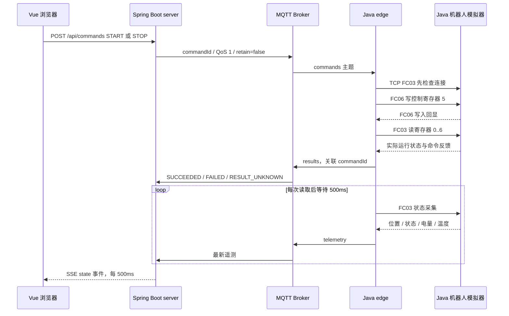

# 架构、分层与当前实现

更新：2026-11-02，完成现有模拟链路的可读性整理和规则提取。文件职责、阅读顺序和检查命令见 [代码阅读指南](CODE_GUIDE.md)。后续功能路线仍见 [前端优先实施说明](FRONTEND_FIRST_PLAN.md)。

## 当前已落地的边界

- 前端：App → ConsoleLayout / MonitoringView → 各监控面板；useDeviceConsole 管会话，api/device 管 HTTP/SSE。样式、导航、状态文案和显示格式独立。
- 后端：DeviceController 管 HTTP，DeviceEventStream 管 SSE；CommandPolicy、CommandHistory、DeviceTelemetry 管纯业务规则；ConsoleService 协调 MQTT 与规则。其他尚未实现的业务仍只有规划目录。
- edge：EdgeApplication 装配与调度，DeviceCommandHandler 管命令校验/去重/执行，ModbusRobotDriver 管寄存器采集与转换。摄像机、迁移和媒体配置仍未实现。
- `scripts/prepare-structure.ps1` 可重建 62 个规划目录，Git 不跟踪空目录，不用占位业务文件伪装实现。
- 单元 3 在共享遥测中增加采样来源、由 edge 提供实际原始值，server 保存实际接收主题；未改协议点表、依赖版本或控制语义，未批量迁移后端。

## 温度来源：事实由哪层提供

模拟器产生温度寄存器；edge 的 `ModbusRobotDriver.readState` 通过真实 FC03 一次读取 0..6，将原始数组保存在 `SamplingEvidence`，并为本次读取生成 UUID `sampleId`。`temperature` 使用同一数组的温度地址除以比例常量；点表名称统一在 `RobotRegisters`。采集失败返回 `evidence=null`，不补造寄存器。

server 收到 telemetry 或有效结果内的遥测时，同时保存对象、接收时间、MQTT 回调里的实际主题 `telemetryTopic`。该主题不由前端拼接，可能是 `/telemetry` 或 `/results`。`capturedAt` 是 edge 读取后的时间，不是设备自身时间；server 仍沿用现有在线规则和 SSE。

`MonitoringView` 的温度按钮打开 `TemperatureSourceDrawer`。组件仅锁定当前遥测快照并展示原值和换算，用户显式刷新才切换样本；当前实时可用性持续跟随 SSE/在线状态，因此检查旧样本时仍能看到断线。锁定只在浏览器内存中，不是数据库历史。

`scripts/observe-telemetry.mjs` 建立独立 MQTT 连接，订阅遥测和结果，输出收到的遥测及 topic，不依赖 server API。以 sampleId 和实际主题对照抽屉与订阅记录；端到端测试另用独立 TCP Socket 读取地址 4。它们可验证通信与换算一致性，来源字段仍由软件采集端声明，不构成硬件认证。操作见 [数据来源核对](DATA_PROVENANCE.md)。

## 模块边界：现在有谁，分别负责什么

| 目录 / 程序 | 当前职责 | 保留的边界 |
| --- | --- | --- |
| web | Vue 3 + Vite，HTTP 控制、SSE 展示 | 展示状态和发起意图，不产生设备测量值 |
| server | Spring Boot，命令记录、最新状态、REST、SSE | 未来管理任务定义、历史和权限，不直接读写 Modbus |
| edge | 普通 Java 独立进程，MQTT 收发、Modbus 采集与控制 | 未来执行逐点任务与调用摄像机，不管理整套业务数据库 |
| simulator/robot | 独立 Java Modbus TCP 服务，模拟运动与寄存器 | 仅设备行为，不承载巡检任务编排 |
| common | 消息 record、JSON、MQTT 客户端、Modbus 客户端 | 是编译时共享库，不是服务，不通过它共享运行时状态 |
| deploy / scripts | Compose/Nginx 与本地构建、运行、验证 | 本地 Broker 是 Aedes，Compose Broker 是 Mosquitto |

`simulator/camera` 仅为空目录；MySQL、Redis、摄像机、视频未接入。server/edge/robot 是独立进程，Maven 多模块不等于多套微服务。保持 Java 17、Spring Boot 3、Vue 3、JavaScript、SSE。ORM 在持久化单元说明并选择，目前未确定。

## server：当前结构与目标分层

当前 `DeviceController` 负责 HTTP 接口和业务异常映射，SSE 集合与广播已提取到 `DeviceEventStream`。`integration/ConsoleService` 仍装配 MQTT 并协调消息和调度，但允许执行的规则、命令状态转换、最新采样与过期判断已分别提取到 `device/domain/`。这些规则不依赖 Spring、HTTP 或 Paho，有独立测试。

目标采用模块化单体：逐步按业务模块落地分层。按本次用户要求已建空目录，只有实际实现时才加入类与接口：

| 层 | 本项目中的例子 | 不应承担的职责 |
| --- | --- | --- |
| 接口层 api | Controller、请求/响应 DTO、校验、HTTP 异常映射 | MQTT 报文解析、任务规则 |
| 应用层 application | 查询设备状态、发送命令、启动任务等用例；权限与事务边界 | 拼 Modbus 报文、直接使用厂商 SDK |
| 领域层 domain | 在线/过期规则、命令/任务状态及允许的转换 | HTTP 状态码、Paho、数据库框架 |
| 基础设施层 infrastructure | MQTT 适配、数据库、Redis、文件与具体驱动 | 决定业务状态转换 |

**依赖方向**：接口层调用应用层，应用层使用领域规则；领域层不反向依赖 Controller 或 MQTT。需要可替换的存储/通信时，由应用层或领域层定义其所需接口，基础设施实现接口，Spring 在装配时注入。运行时仍会调用具体 MQTT/数据库代码，但业务代码不必知道具体实现。简单纯函数规则或查询 DTO 不必每个都再配接口。

例如“设备是否在线”已由 `DeviceTelemetry` 根据采集时间、接收时间和连接事实决定；“如何订阅 MQTT”仍由 `ConsoleService` 使用 `MqttLink` 完成。后续新增任务或持久化时继续按实际用例分离，避免继续堆入协调服务。

## 前端与 edge 的调整方向

- 前端：`views` 组合面板，`layouts` 管导航外壳，`api` 封装 HTTP/SSE，`composables` 管会话状态与生命周期。`components/monitoring` 各自负责一个监控面板或弹窗；路由与 stores 仍未引入实现。
- edge：保持普通 Java。命令处理依赖 `RobotDriver` 的读状态和写控制能力，Modbus 实现与协议证据由 `ModbusRobotDriver` 提供。单线程 worker 保持采集与写入顺序。真正接入摄像机时再建立对应驱动。
- common：MQTT 消息是跨进程契约，不等于 server 的领域模型或 Web 响应 DTO。当前 `common` 还包含具体 Paho/Modbus 实现，机器人依赖它也会带入不需要的 MQTT/JSON 依赖；后续按实际使用拆边界，本轮保留。

## 状态归属与能力边界

| 状态 / 能力 | 当前归属与实现 | 后续扩展位置 |
| --- | --- | --- |
| 机器人 RUNNING/STOPPED | 模拟器寄存器为设备反馈事实，edge 读取 | 不同设备驱动将厂商点表映射为统一状态 |
| 命令 PENDING/SENT/终态 | server 记录；edge 判断执行结果 | application 编排、domain 转换规则、SQL 操作记录 |
| 接收/执行中间状态 | 没有独立 ACCEPTED/EXECUTING 反馈 | 需要时补执行事件，不把 SENT 当作设备已接收/已执行 |
| 巡检任务状态 | 尚未实现；START 只是启动运动 | server 管定义和记录，edge 管逐点执行，同设备一个活动任务 |
| 最新遥测与在线判定 | DeviceTelemetry，拒绝较旧和重复采样，有回归测试 | 未来使用 Redis 保存可重建快照 |
| 幂等 | edge 进程内 120 秒命令账本 | 业务事件的 eventId / 唯一键在持久化单元实现 |
| 多设备/不同厂商 | 有 deviceId 和主题，但只运行一台 | 设备登记、能力查询与驱动选择，不宣称已有多设备支持 |
| 历史、告警、文件 | 尚未实现 | MySQL 业务事实、迁移、事务、唯一键；文件元数据与持久卷 |
| 权限/审计 | 无鉴权，本地 loopback 演示 | 访客只读、管理员操作；公网前完成；诊断日志不等于操作审计 |
| 摄像机/视频/真实 SDK | 尚未实现 | edge HTTP 模拟 CameraDriver；媒体服务独立；硬件授权后再扩展 |
| 运维 | 环境变量、脚本、文本日志、server 存活接口 | 配置校验、关联 ID 日志、依赖就绪检查、持久化服务健康检查 |

MySQL 与 Redis 不存两套业务事实；图片走 HTTP/文件服务而非 MQTT。文件与数据库不是一个天然原子事务，归档失败与元数据一致性需在文件单元制定策略。容器运行、业务持久化和公网接入未验收。

## 当前通信数据流

## 职责

- `web/`：Vue 3 通过 REST 发起操作，通过 EventSource 接收 SSE。位置与指标来自 edge 的网络采集；浏览器不生成机器人运动数据。
- `server/`：Spring Boot 管理操作记录、在线判定与 SSE；不直接访问机器人寄存器。控制请求互斥，运行时再次 START 返回 409。
- `edge/`：独立 Java 17 进程，单线程串行命令和采集，负责 MQTT 与 Modbus 转换。后续阶段在这里加入逐点任务执行和 CameraDriver。
- `simulator/robot/`：只提供简单运动行为和真实 Modbus TCP 服务，没有业务任务编排。每 250ms 更新模拟状态，可独立停止。
- `common/`：共享消息定义、MQTT 连接与 Modbus 客户端。共享代码不等于共享内存状态，所有业务链路都经过网络。

## 为什么写入回显还不够

MQTT QoS 1 确认 Broker 接收消息，不确认 edge 执行，更不确认设备运动。FC06 回显表明寄存器写请求被接受。edge 在写入后执行 FC03，验证运行状态与控制反馈，才返回 SUCCEEDED。

如果写入前读操作已经失败，命令显示 FAILED；写入开始后 Socket 超时/断连，无法判断设备是否已动作，显示 RESULT_UNKNOWN。收到明确 Modbus 异常响应时显示 FAILED。server 在 8 秒内没有执行反馈也显示 RESULT_UNKNOWN，不自动重发。

## TCP 字节流与边界

`DataInputStream` 的基本类型读取与 `readFully` 支持报文拆分到多次 TCP 读取。先读取 7 字节 MBAP，再按 length-1 读取 PDU。客户端核验事务 ID、protocol=0、Unit ID、长度、功能码、异常 PDU、FC03 byte count 和 FC06 回显。

模拟器逐帧处理连接上的连续请求，验证 PDU 长度、地址、数量与写值，返回功能码异常响应。单次请求 1 秒 Socket 超时；错误后关闭连接，下一次采集建立新 Socket，重新读取真实状态。无自动控制重放。

## 断线与幂等边界

edge/server 每 2 秒尝试 MQTT 连接并重新订阅。使用 clean session；命令不 retain、不在本地缓存待发送控制，不在重连时重放。模拟器恢复后 edge 重新读取状态；模拟器重启初始 STOPPED。

edge 按 commandId 保存 120 秒的进程内命令/结果账本，同一完整消息重复投递只重发已缓存结果，不执行 FC06。相同 commandId 携带不同 payload 返回 FAILED。命令有效期最多 30 秒，当前 server 发出 8 秒有效命令。超过账本保留期的旧消息也因过期被拒绝。这是运行进程内去重，不是跨 edge 崩溃的物理动作恰好一次。

server 在收到遥测超过 3 秒、设备采集时间过期或 Broker 不可用时标记数据不可用；前端 SSE 断开也立即隐藏实时指标。位置示意图保留上次位置并降低透明度，明确显示上次位置而非实时位置。正常在线与业务运行状态分开显示。

## 阶段边界与存储

阶段 A 最近 100 条指令和诊断存内存，SSE 推送状态快照。没有对尚未接入的数据库或摄像机提供虚假成功接口。阶段 B 才引入 MySQL 任务/事件/告警/文件元数据唯一键，以及 Redis 最新遥测与更新时间。阶段 C 增加管理员鉴权与公网只读入口；当前五个本地进程只监听 loopback，Compose 只暴露 loopback Web。
